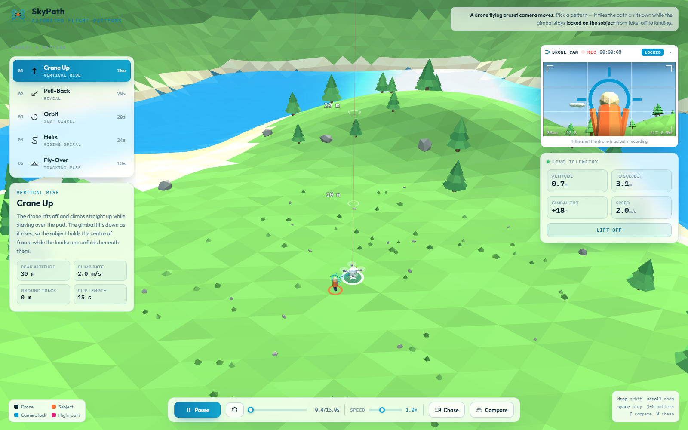

# SkyPath

[](https://github.com/alzin/SkyPath/actions/workflows/ci.yml)
[](https://github.com/alzin/SkyPath/actions/workflows/pages.yml)
[](LICENSE)

SkyPath is an interactive WebGL visualization of five automated cinematic drone moves. It combines procedurally generated terrain, subject-locked camera framing, a chase camera, an on-board view, and live flight telemetry in one dependency-light web page.

**[Open the live demo](https://alzin.github.io/SkyPath/)**



> [!IMPORTANT]
> SkyPath is a browser visualization and educational prototype. It does not connect to, command, navigate, or provide safety guidance for a real drone.

## Highlights

- Five reusable camera-move studies with automatic subject tracking
- Free-orbit, chase, and simulated on-board camera views
- Live altitude, distance, gimbal angle, speed, phase, and time readouts
- Playback, replay, timeline scrubbing, and 0.4×–2× speed controls
- Compare mode for seeing every trajectory at once
- Procedural terrain, sea, clouds, drone, subject, and flight paths
- No framework, bundler, backend, account, first-party analytics, or application data storage

## Flight patterns

| Pattern | Move | Duration | Key geometry |
| --- | --- | ---: | --- |
| Crane Up | Vertical rise | 15 s | 30 m peak altitude |
| Pull-Back | Diagonal reveal | 20 s | 10 m rise, 14 m retreat |
| Orbit | 360° circle | 20 s | 8 m altitude, 7 m radius |
| Helix | Rising spiral | 24 s | 22 m peak, 1.5 turns, 3–12 m radius |
| Fly-Over | Tracking pass | 13 s | 7 m altitude, 34 m run |

## Quick start

The app has no build step. Clone the repository and serve its root with any static HTTP server:

```sh
git clone https://github.com/alzin/SkyPath.git
cd SkyPath
python -m http.server 8000
```

Open <http://localhost:8000/> in a modern, WebGL-capable browser. An internet connection is required for Three.js and the Google-hosted fonts.

Opening `index.html` directly also works in most browsers, but an HTTP server more closely matches the deployed environment.

## Controls

| Input | Action |
| --- | --- |
| Drag / touch-drag | Orbit the study camera |
| Mouse wheel | Zoom |
| Space | Play or pause |
| R | Replay the selected pattern |
| 1–5 | Select a flight pattern |
| C | Toggle all-path comparison |
| V | Toggle chase camera |
| Arrow keys on timeline | Scrub the flight; hold Shift for larger steps |

The primary pattern, playback, speed, and camera actions are also available through the on-screen controls, including a compact pattern picker on narrow layouts.

## How it works

SkyPath intentionally keeps its runtime simple:

- `index.html` contains the interface, visual styles, scene construction, trajectory definitions, and animation loop.
- Each entry in `PATTERNS` provides metadata, a normalized `pos(progress)` trajectory, and a `phase(progress)` status function.
- Three.js renders one procedural scene through a study camera and a picture-in-picture drone camera.
- The gimbal and tracking overlays continuously aim at the fixed subject while telemetry is derived from the active trajectory.

To add a pattern, define its metadata and position function in `PATTERNS`. Keep `progress` normalized from `0` to `1`, return positions in metres, and include a readable phase description. Please add or update the pattern table and manually exercise the move before opening a pull request.

## Development

Repository checks use Node.js 24 and HTML Validate:

```sh
npm ci
npm test
```

The test command validates the HTML, compile-checks the inline JavaScript, verifies required project files, and checks the pinned Three.js integrity attributes. See [CONTRIBUTING.md](CONTRIBUTING.md) for the full review checklist.

## Project structure

```text
.
├── .github/              GitHub workflows and contribution templates
├── docs/                 README and social preview assets
├── scripts/              Dependency-light repository checks
├── index.html            Complete interactive application
├── favicon.svg           Project icon
└── README.md             Project documentation
```

## Security and support

Use GitHub Issues for reproducible bugs and GitHub Discussions for usage questions and ideas. Please report security concerns privately as described in [SECURITY.md](SECURITY.md).

## Acknowledgments

- [Three.js](https://threejs.org/) powers the WebGL rendering and is loaded from cdnjs at pinned release r128 with Subresource Integrity.
- [Outfit](https://fonts.google.com/specimen/Outfit) and [IBM Plex Mono](https://fonts.google.com/specimen/IBM+Plex+Mono) are loaded through Google Fonts.

## License

SkyPath is available under the [MIT License](LICENSE).
